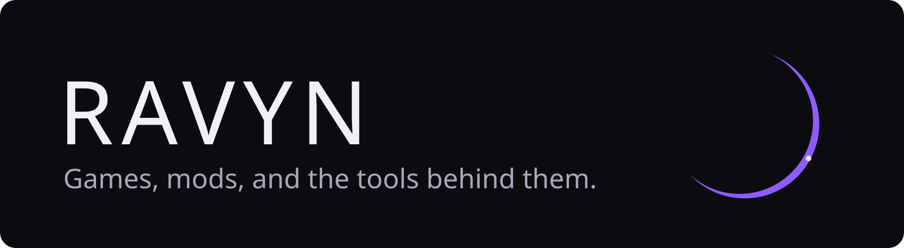
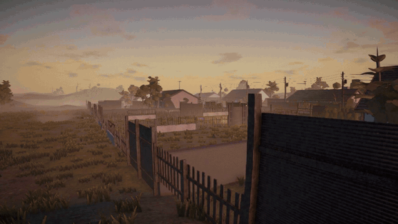

<picture>
  <source media="(max-width: 600px)" srcset="assets/banner-mobile.svg">
  
</picture>

I make co-op horror games in Unity and run the RAVYN: Riftfall community.

### Currently building: Dusk Crew

Build light by day, rescue people in the dark by night. First-person co-op for one or two players.

  
  

**Free demo on itch.io — 21 Dec.** Screenshots, features and devlog are on the [Dusk Crew press page](https://github.com/ravynarchlab-source/dusk-crew-showcase).

**Stack:** Unity (URP), C#, Photon PUN 2, Blender, Python, Luau.

**Contact:** [Discord — RAVYN: Riftfall](https://discord.gg/YMws83FPS) · [ravynarchlab-source.github.io](https://ravynarchlab-source.github.io)
