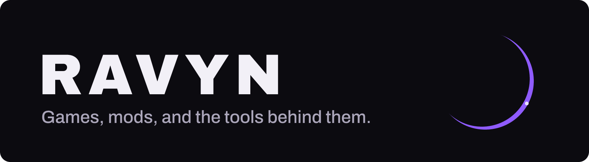

I make games and mods, and I build most of my own tooling to get there. Unity and Roblox take up most of my week. The rest goes into pulling other games apart to see how they work.

### Working on

**PROJECT_X** (codename) 
First-person co-op horror in Unity, presented like bodycam footage. Not public yet.

**RAVYN: ECHO** 
Co-op dungeon game on Roblox for 1 to 4 players. Lineages, skill fusion, and a "server admin" voice that talks you through every run.

### Running

**RAVYN | ATM10 Hardcore** 
Public Minecraft server. All the Mods 10 on NeoForge 1.21.1, hardcore rules. Join at [playravyn.com](https://playravyn.com).

**60 Seconds! Reatomized in Gulf Arabic** 
Fan translation with full right-to-left support, about 3,800 strings. Finished, waiting on the developer's go-ahead.

### Tools

Unity and C#, Roblox and Luau, Blender, Python, Node.js. Git for all of it.

### Find me

Discord: [RAVYN: Riftfall](https://discord.gg/YMws83FPS) 
Minecraft: [playravyn.com](https://playravyn.com)
